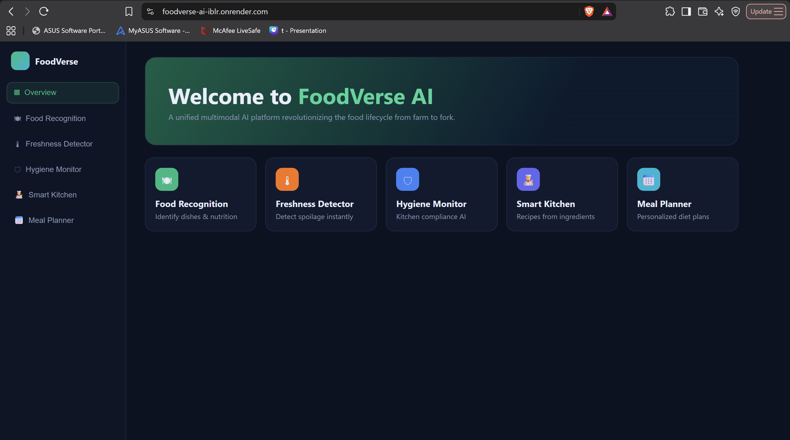
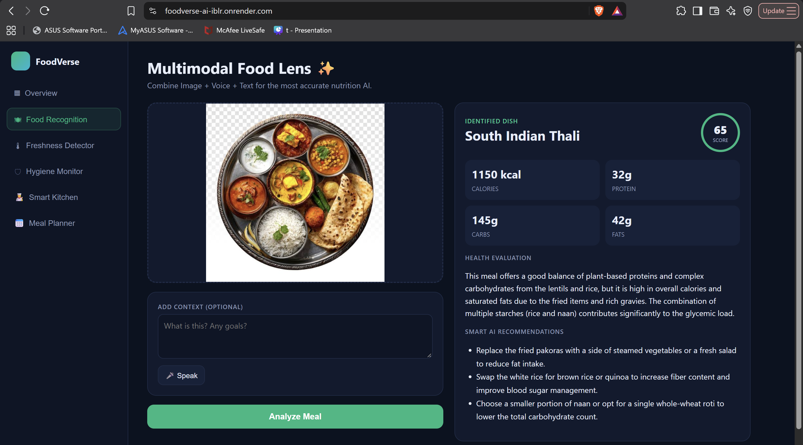
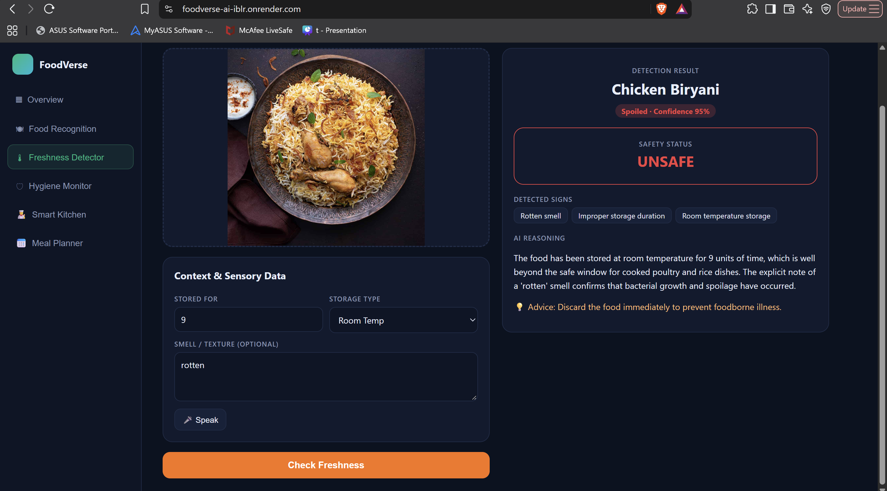
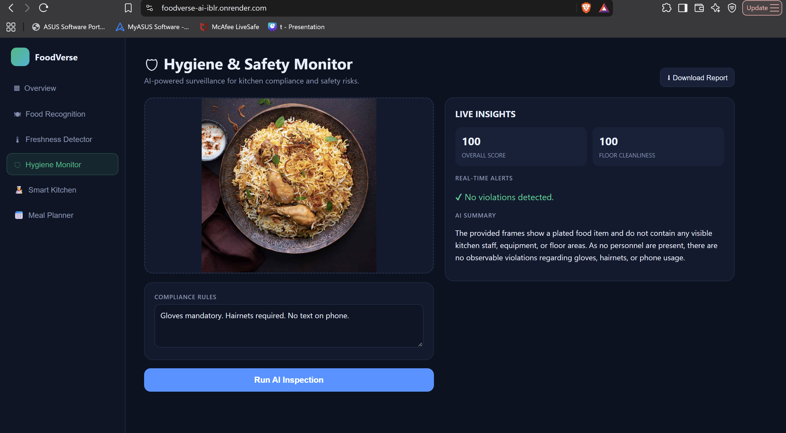
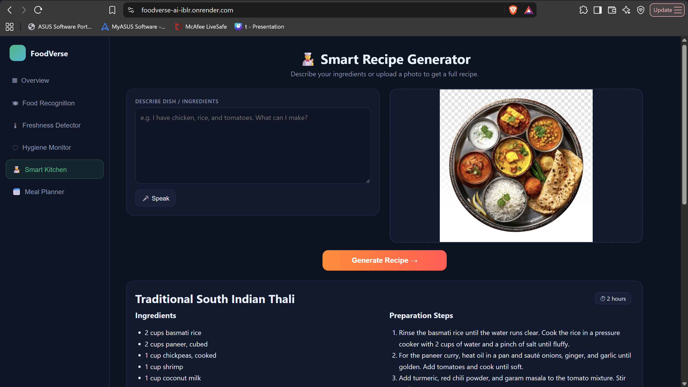
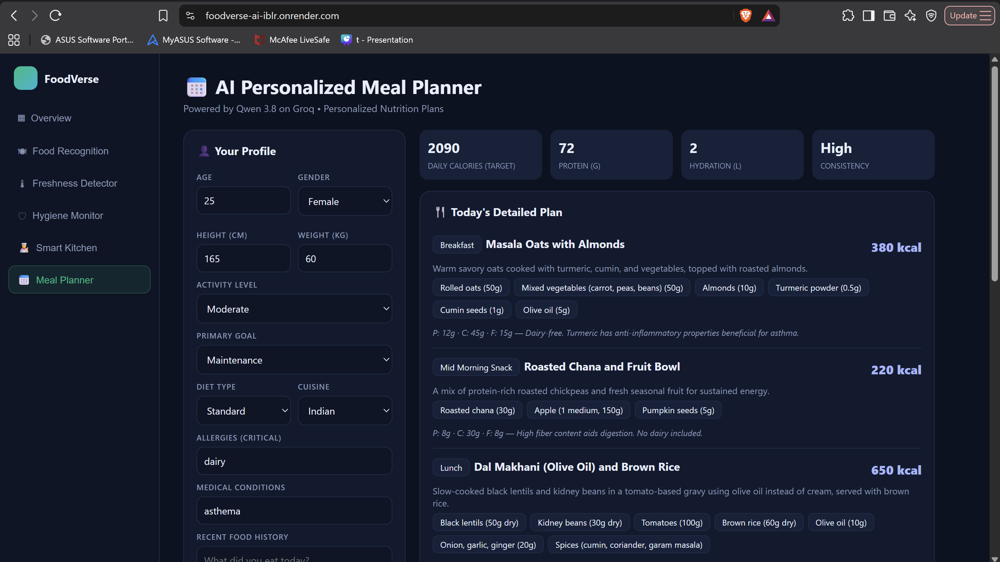

# FoodVerse AI - Multimodal Food Intelligence Agent

A multimodal AI platform that analyzes food across five dimensions: nutrition, freshness, kitchen hygiene, cooking guidance and personalized meal planning. It combines computer vision, video-frame analysis and large language model reasoning behind one web interface.

**Live demo:** https://foodverse-ai-iblr.onrender.com
*(Hosted on a free plan: if the site has been idle, the first load can take up to a minute to wake up.)*

## Features

| Module | Input | Output |
|---|---|---|
| Food Recognition | Food photo + optional voice or text note | Dish name, calories, protein/carbs/fats, health score, healthier suggestions |
| Freshness Detector | Food photo + storage time, storage type, smell/texture notes | Fresh / moderately fresh / spoiled, confidence, safety status, detected signs, advice |
| Hygiene Monitor | Kitchen image or video + compliance rules | Compliance score, floor cleanliness, severity-ranked alerts, summary, downloadable report |
| Smart Kitchen | Ingredients as text, voice or photo | Full recipe with ingredients and ordered steps |
| Meal Planner | Age, height, weight, goal, diet, allergies | Calorie and protein targets, daily meal plan, weekly overview, AI coach tips |

## Screenshots

| | |
|---|---|
|  |  |
|  |  |
|  |  |

## How it works

1. The React interface collects images, video, voice (browser speech recognition) or form data.
2. The FastAPI backend preprocesses inputs: images are resized and normalized, and videos are sampled into evenly spaced frames with OpenCV.
3. A vision-language model (Qwen 3.8 27B, served through the Groq API) analyzes the inputs and returns structured JSON.
4. The Meal Planner calculates calorie targets itself with the Mifflin-St Jeor equation and activity multipliers, then asks the model to build the plan around those numbers.
5. The interface renders the results as dashboards and reports.

## Tech stack

- **Backend:** Python 3.11, FastAPI, Uvicorn, Pydantic
- **AI:** Groq API with Qwen 3.8 27B (vision + language)
- **Computer vision:** OpenCV, Pillow, NumPy
- **Frontend:** React 18, HTML, CSS (animations), JavaScript
- **Deployment:** Render

## Project structure

```text
foodverse-ai/
├── backend/
│   ├── main.py            # FastAPI app: 5 AI modules + serves the frontend
│   └── requirements.txt
├── frontend/
│   └── index.html         # React single-page interface
├── docs/                  # Screenshots
└── README.md
```

## Run locally

```bash
git clone https://github.com/tanishqrajsinghchawda/foodverse-ai.git
cd foodverse-ai
conda create -n foodverse python=3.11 -y
conda activate foodverse
pip install -r backend/requirements.txt
```

Create a `.env` file in the project root:

```text
GROQ_API_KEY=your_groq_api_key
```

Start the server and open http://127.0.0.1:8000

```bash
cd backend
uvicorn main:app --reload
```

## API endpoints

| Method | Endpoint | Purpose |
|---|---|---|
| POST | `/api/food-recognition` | Food identification and nutrition |
| POST | `/api/freshness` | Freshness and spoilage detection |
| POST | `/api/hygiene` | Kitchen hygiene inspection (image or video) |
| POST | `/api/recipe` | Recipe generation |
| POST | `/api/meal-plan` | Personalized meal plan |
| GET | `/api/health` | Health check |

Interactive API docs are available at `/docs`.

## Limitations

Nutrition values and freshness assessments are AI estimates and are not a substitute for professional medical or food-safety advice.

## Author

Tanishq Raj Singh Chawda - MCA, Medicaps University
Enrollment Number - EN25CA5030108